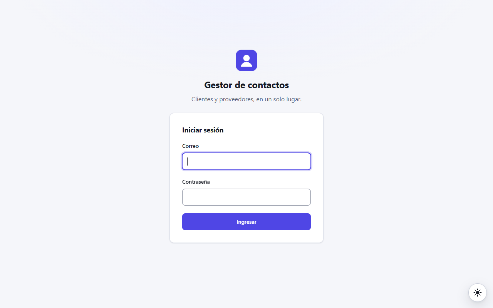
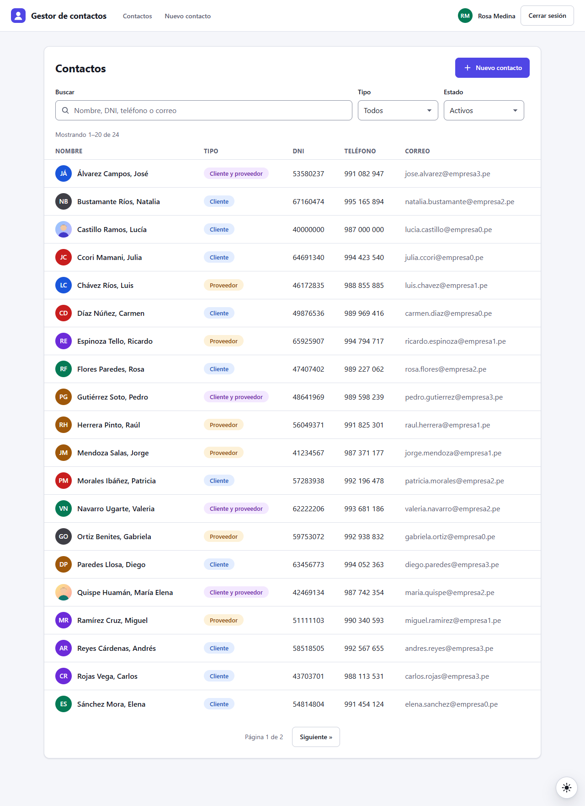
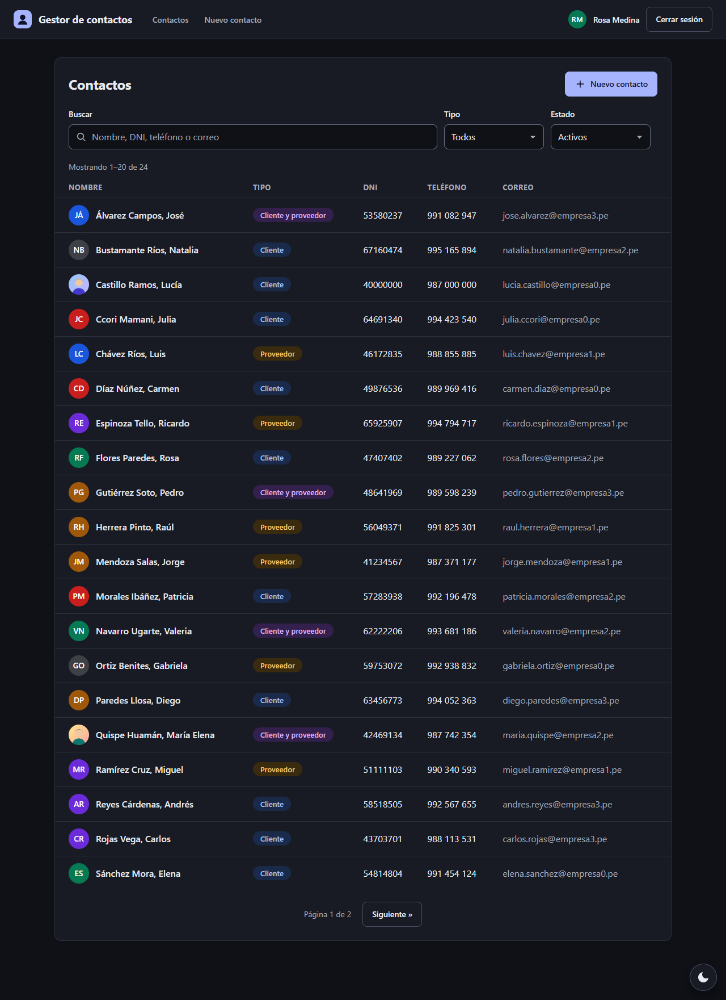
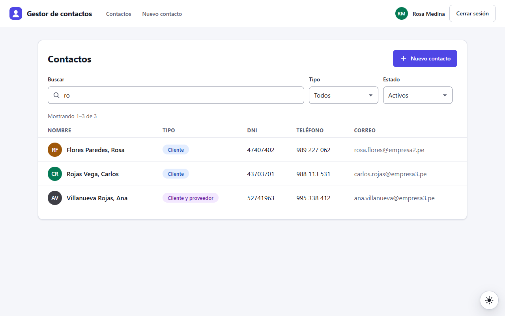
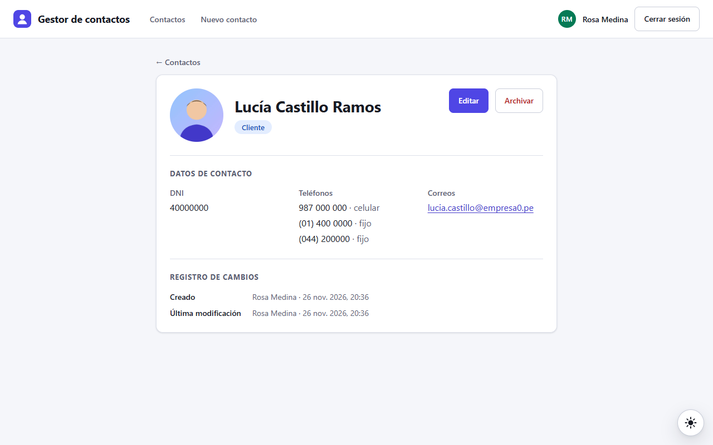
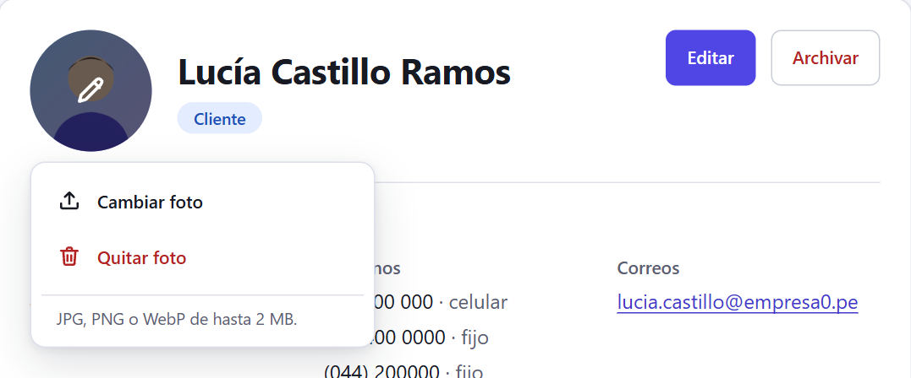
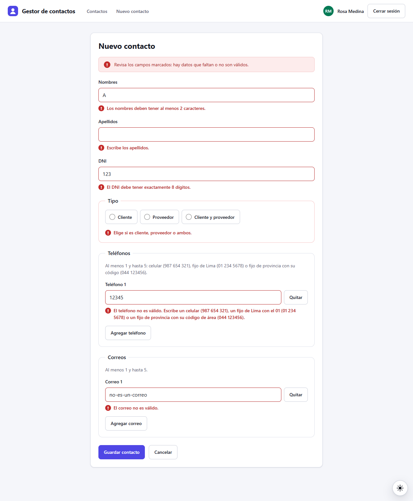
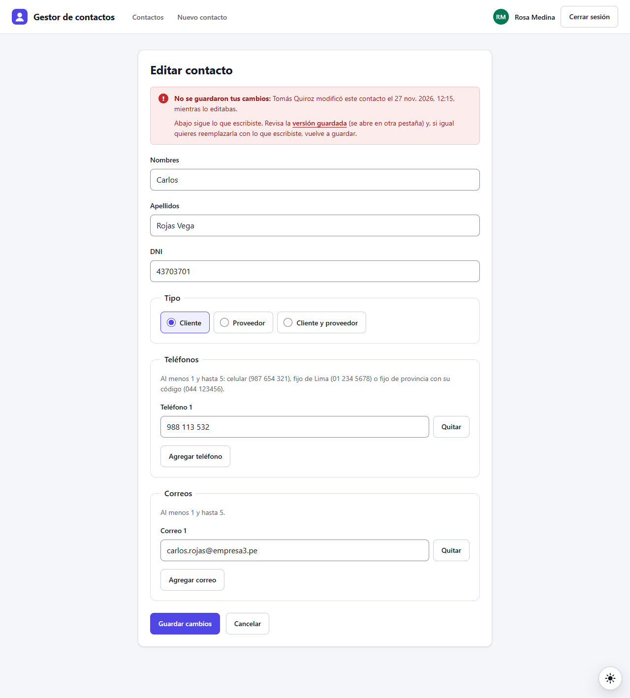
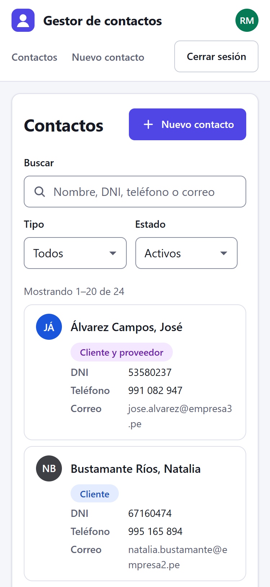
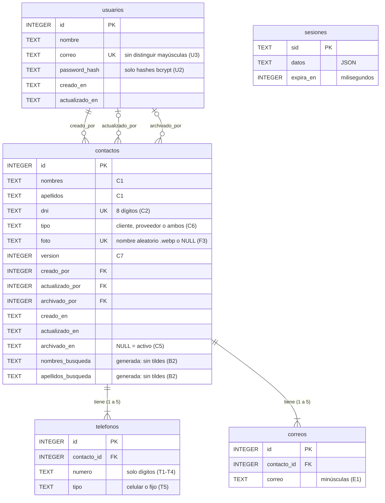

# Gestor de contactos

Sistema web para que una pequeña empresa gestione sus contactos, clientes y proveedores. Hoy esos contactos viven en hojas de cálculo, y eso trae tres problemas: se pierden datos, hay duplicados y no hay control de acceso. El sistema resuelve los tres:

- **Pérdida de datos:**
  - eliminar un contacto lo archiva, y se puede restaurar (C5);
  - si dos personas editan el mismo contacto a la vez, ninguna pisa sin saberlo los cambios de la otra (C7);
  - cada contacto guarda quién lo creó, lo modificó y lo archivó (A1).
- **Duplicados:**
  - el DNI es único en todo el sistema, incluidos los archivados (C2);
  - teléfonos y correos se normalizan antes de guardarse (T1–T4, E1).
- **Control de acceso:**
  - solo entran usuarios creados desde la consola (U1);
  - contraseñas con bcrypt (U2);
  - límites de intentos de inicio de sesión (U5, U7).

## Capturas

| Inicio de sesión | Listado |
|---|---|
|  |  |

| Listado en modo oscuro | Búsqueda en vivo ("ro") |
|---|---|
|  |  |

| Ficha con foto | Menú de la foto |
|---|---|
|  |  |

| Formulario con errores | Ediciones simultáneas (C7) |
|---|---|
|  |  |



Todos los datos de las capturas son ficticios. Son los mismos que carga `npm run db:demo`.

## Cómo levantar el proyecto

### Requisitos

- **Node.js 22.9 o posterior.** El proyecto usa `--env-file-if-exists` y `--watch`, que vienen con Node, así que no necesita `dotenv` ni `nodemon`. El archivo `.nvmrc` indica la versión 22. El archivo `.npmrc` tiene `engine-strict=true`, así que `npm ci` se detiene con un error si la versión de Node no cumple.
- No hace falta instalar SQLite: `better-sqlite3` lo trae incluido.

### Pasos en Windows (PowerShell)

```powershell
# 1. Instalar las dependencias exactas de package-lock.json
npm ci

# 2. Crear el archivo de configuración a partir de la plantilla
Copy-Item .env.example .env
# En CMD: copy .env.example .env

# 3. Generar un secreto para la cookie de sesión y pegarlo en .env, en SESSION_SECRET=
node -e "console.log(require('node:crypto').randomBytes(32).toString('hex'))"

# 4. Crear la base de datos (aplica las migraciones pendientes)
npm run db:migrate

# 5. Crear un usuario: pide nombre, correo y contraseña (mínimo 10 caracteres)
npm run user:create

# 6. (Opcional) Cargar 25 contactos ficticios para ver la app con datos
npm run db:demo

# 7. Arrancar en modo desarrollo (se reinicia al cambiar el código)
npm run dev
```

Abre <http://localhost:3000> e inicia sesión con el usuario del paso 5.

Para correr las pruebas, ejecuta `npm test`. Usan bases de datos en memoria o temporales y nunca tocan `storage/contactos.db`.

### macOS o Linux

Los pasos son los mismos. Solo cambia el paso 2:

```bash
cp .env.example .env
```

### Sobre `npm run db:demo`

- Carga 25 contactos inventados: 24 activos y 1 archivado, de los tres tipos, y 2 con foto (avatares ilustrados, no fotos de personas).
- Los crea con los mismos servicios que usa la app, así que cada dato pasa por las mismas validaciones.
- El autor que queda en la auditoría es el primer usuario.
- Se niega, sin cambiar nada, en estos casos:
  - en producción;
  - si hay migraciones pendientes;
  - si no hay usuarios;
  - si la base de datos ya tiene contactos.

  Así nunca mezcla datos de demostración con datos reales.

### Variables de `.env`

`src/config/index.js` es el único archivo que lee las variables de entorno, y las valida con zod al arrancar. Si una variable está vacía, toma su valor por defecto. Si tiene un valor inválido (por ejemplo `PORT=abc` o `NODE_ENV=prod`), el arranque se detiene con un mensaje que dice qué variable corregir.

| Variable | Para qué sirve | Por defecto |
|---|---|---|
| `PORT` | Puerto HTTP. | `3000` |
| `HOST` | Dirección en la que escucha el servidor. Vacía: en desarrollo, solo esta computadora (`127.0.0.1`); en producción, todas las interfaces, como necesitan un proxy o un contenedor. Para probar desde otro equipo de la red en desarrollo, usa `0.0.0.0`: el servidor avisará al arrancar que la cookie de sesión no es segura fuera del modo producción. | ver la descripción |
| `NODE_ENV` | `development`, `production` o `test`. En `production` la cookie lleva `Secure` y el prefijo `__Host-`, y se activa HSTS. | `development` |
| `SESSION_SECRET` | Secreto con el que se firma la cookie de sesión. **Obligatorio**: sin él, o con menos de 32 caracteres, el servidor no arranca. | ninguno |
| `DATABASE_PATH` | Archivo SQLite. | `storage/contactos.db` |
| `UPLOADS_PATH` | Carpeta de las fotos. Debe quedar fuera de `public/`. | `storage/uploads` |
| `TRUST_PROXY` | Cuántos proxies hay delante de la app (Nginx, Render…), normalmente `1`. Vacío si no hay ninguno. Sin este valor, detrás de un proxy Express no detecta HTTPS y todas las peticiones parecen venir de la IP del proxy. | sin proxy |

## Reglas de negocio

Las reglas completas, cada una con su porqué, están en [`docs/REGLAS-NEGOCIO.md`](docs/REGLAS-NEGOCIO.md). Cada regla tiene un código, y ese código se cita en el código y en las pruebas que la implementan. Todas se validan en el servidor con zod. Cuando SQLite puede verificar una regla (`NOT NULL`, `UNIQUE`, `CHECK`, `FOREIGN KEY`, triggers), también se aplica en la base de datos, como segunda barrera.

| Grupo | Reglas |
|---|---|
| Contacto (C1–C7) | Nombres y apellidos con letras del español (C1). DNI de 8 dígitos, único incluso entre los archivados; si el DNI es de un archivado, se ofrece restaurarlo (C2). De 1 a 5 teléfonos y de 1 a 5 correos, sin repetir (C3). Foto opcional, con un avatar de iniciales si no hay (C4). Eliminar es archivar (C5). Tipo cliente, proveedor o ambos (C6). Ediciones simultáneas (C7). |
| Teléfonos de Perú (T1–T5) | Se aceptan espacios, guiones y paréntesis, y se guarda solo en dígitos (T1). Celular de 9 dígitos que empieza con 9; se acepta `+51` al escribir (T2). Fijo de Lima, `01` más 7 dígitos (T3). Fijo de provincia, con uno de los 23 códigos de área vigentes; se acepta el 0 inicial al escribir (T4). El tipo, celular o fijo, se deduce del número (T5). |
| Correo (E1) | Formato válido, máximo 254 caracteres, guardado en minúsculas. |
| Foto (F1–F5) | JPG, PNG o WebP de hasta 2 MB (F1). El tipo se valida por el contenido del archivo, no por su extensión (F2). Toda foto se reprocesa: se endereza, se redimensiona a 512 px como máximo, se convierte a WebP, se le quitan los metadatos y se guarda con un nombre aleatorio (F3). Máximo 25 megapíxeles (F4). Quitar la foto pide confirmación (F5). |
| Usuarios (U1–U7) | Sin registro público (U1). Contraseña de 10 caracteres a 72 bytes, guardada con bcrypt (U2). Correo único (U3). Mensaje de error único y sesión de 30 días renovable (U4). Límite de intentos de inicio de sesión (U5). Sin roles (U6). Límite de visitas al formulario de inicio de sesión (U7). |
| Auditoría (A1) | Quién creó, modificó por última vez y archivó cada contacto, y cuándo. |
| Búsqueda (B1–B3) | Búsqueda mientras se escribe por nombre, DNI, teléfono o correo (B1). Sin distinguir tildes ni mayúsculas (B2). 20 contactos por página, conservando los filtros (B3). |

El porqué de las principales:

- **El DNI es único también entre los archivados (C2).** Los duplicados son el principal problema del cliente, y archivar no es borrar: aceptar de nuevo un DNI archivado crearía un duplicado. Por eso se ofrece restaurar el contacto que ya existe.
- **Eliminar es archivar (C5).** Hoy se pierden datos. Archivar permite deshacer un error.
- **Ediciones simultáneas (C7).** Sin este control, quien guarda al último borra sin aviso el trabajo de la otra persona, que es lo que hoy pasa con las hojas de cálculo compartidas.
- **Los teléfonos se guardan solo en dígitos (T1–T4).** Cada persona escribe el número a su manera, y guardar solo los dígitos permite detectar repetidos y buscar sin depender del formato. Los códigos de área son la lista exacta del MTC, no un rango, para detectar códigos que no existen.
- **Las fotos se reprocesan (F2–F4).** La extensión de un archivo se puede falsificar, los metadatos pueden revelar dónde se tomó la foto, y una imagen "bomba" de pocos KB puede agotar la memoria al procesarla.
- **El límite de intentos es por IP y correo (U5).** En una oficina todos salen a internet con la misma IP. Si el límite fuera solo por IP, los errores de una persona bloquearían a las demás.

## Decisiones principales

### Stack

| Pieza | Por qué |
|---|---|
| **Node.js + Express 5**, un monolito con vistas **EJS** renderizadas en el servidor | Es una aplicación interna pequeña: un solo proceso, sin una API separada ni un paso de compilación del frontend. Las páginas funcionan sin JavaScript. |
| **SQLite** con **better-sqlite3** | Un solo archivo, sin un servidor de base de datos que instalar. Usa tablas `STRICT`, modo WAL y claves foráneas activas (`src/db/conexion.js`). |
| SQL escrito a mano en **migraciones** (`src/db/migrations/*.sql`), sin ORM | El esquema completo se lee en tres archivos, y las reglas quedan como `CHECK`, `UNIQUE` y triggers. Cada migración se aplica en su propia transacción y queda registrada en `schema_migrations`. |
| **zod** | Valida en el servidor los formularios y también la configuración. |
| **express-session** con un almacén propio en SQLite | Unas 70 líneas (`src/db/almacen-sesiones.js`) en lugar de otra dependencia. |
| **bcryptjs** | bcrypt sin compilar código nativo. |
| **multer** (en memoria) + **sharp** | Reciben la foto y la reprocesan antes de escribir nada en el disco. |
| **helmet**, **express-rate-limit** | Cabeceras de seguridad, CSP y límites de intentos. |
| **node:test** + **supertest** | El ejecutor de pruebas que trae Node, sin Jest ni Mocha. |

- `ejs` está fijada en **3.1.10**, sin `^`. En 2026 se publicaron cuatro versiones mayores en menos de un año, sin notas de versión, lo que es una señal de riesgo de cadena de suministro. La 3.1.10 corrige la última CVE publicada (CVE-2024-33883).
- Todos los scripts de npm funcionan en Windows, que es el sistema de desarrollo.

### Modelo de datos

El esquema queda así después de las migraciones `001` a `003`:



- `telefonos` y `correos` tienen `UNIQUE (contacto_id, …)` (C3). Dos triggers impiden pasar de 5 por contacto.
- Las claves foráneas a `usuarios` son `ON DELETE RESTRICT`, así que un usuario que figura en la auditoría no se puede borrar.
- `sesiones` no tiene claves foráneas: guarda la sesión serializada de express-session.
- Las fechas se guardan como texto ISO 8601 en UTC y se muestran en la hora de Perú.

### Sesión persistente

- El almacén propio guarda las sesiones en la tabla `sesiones`. Por eso una sesión sobrevive a recargar la página, a cerrar el navegador y a reiniciar el servidor.
- Una sesión anónima (la del formulario de inicio de sesión, que lleva su token CSRF) dura 1 día.
- Al iniciar sesión, el id se regenera y la sesión pasa a durar 30 días. Esa duración se renueva con cada uso (`rolling`), así que solo vence tras 30 días sin entrar.
- Cerrar sesión borra la fila de la base de datos y la cookie. Una cookie copiada deja de servir.
- Las sesiones vencidas se borran al arrancar y luego cada 15 minutos.
- En producción la cookie se llama `__Host-gestor.sid`: el navegador la exige con HTTPS, con `Path=/` y sin dominio, así un subdominio no puede reemplazarla.

### Seguridad

| Medida | Dónde |
|---|---|
| Contraseñas con bcrypt de costo 12. Si el correo no existe, se compara contra un hash falso del mismo costo, así la respuesta tarda lo mismo y el mensaje es siempre "Correo o contraseña incorrectos" (U4). | `src/services/usuarios.js` |
| El id de sesión se regenera al iniciar sesión, contra la fijación de sesión. | `src/routes/auth.js` |
| Cookie `httpOnly` y `sameSite=lax`; en producción, también `Secure` y el prefijo `__Host-`. El servidor no arranca sin un `SESSION_SECRET` de al menos 32 caracteres. | `src/middlewares/sesion.js` |
| Las rutas son privadas por defecto: las públicas se registran antes de `requiereSesion` y todas las demás después. | `src/app.js` |
| CSRF con token sincronizado en todo POST, incluidos el inicio y el cierre de sesión, comparado en tiempo constante. Las rutas multipart (la foto) se declaran en `RUTAS_MULTIPART` y verifican el token después de multer. La excepción se decide por método y ruta, nunca por `Content-Type`. | `src/middlewares/csrf.js`, `src/routes/contactos.js` |
| CSP estricta con helmet: sin scripts ni estilos en línea, todo desde `'self'`, `frame-ancestors 'none'`. HSTS en producción. | `src/middlewares/seguridad.js` |
| `Cache-Control: no-store` en toda respuesta dinámica, para que los datos personales no queden en la caché ni se vean con "Atrás" después de cerrar sesión. | `src/middlewares/seguridad.js` |
| Límite de intentos de inicio de sesión por IP y correo (5 cada 8 minutos) y por IP (30), y límite de visitas al formulario (100 cada 10 minutos por IP). | `src/middlewares/limite-login.js` (U5, U7) |
| Todas las consultas SQL usan parámetros. En las búsquedas, `%`, `_` y `\` se escapan dentro de `LIKE`. | `src/services/` |
| Las vistas usan siempre `<%= %>`, que escapa el HTML. `<%- %>` se usa solo para `include`. | `src/views/` |
| Fotos: el tipo se valida por el contenido, con un límite de 2 MB y 25 megapíxeles. Se reprocesan a WebP sin metadatos y se guardan con un nombre aleatorio fuera de `public/`. Solo se sirven con sesión iniciada, por `/fotos/:nombre`, con `nosniff`. La base de datos solo acepta nombres de 32 caracteres hexadecimales seguidos de `.webp`. | `src/services/fotos.js`, `src/routes/fotos.js` |
| Los errores nunca muestran el stack ni el mensaje interno. Un envío de foto mal formado responde 400, no 500. | `src/middlewares/errores.js` |
| La configuración se valida al arrancar. En desarrollo el servidor escucha solo en `127.0.0.1`, y avisa si queda accesible desde la red sin el modo producción. | `src/config/index.js`, `src/server.js` |
| Los secretos van solo en `.env`, que no se sube a git. Después de cada instalación se corrió `npm audit`. | `.gitignore`, `.env.example` |

## Lo que agregué por mi cuenta

Algunas de estas ideas fueron mías y otras fueron propuestas del agente que decidí incluir; en [`docs/BITACORA-IA.md`](docs/BITACORA-IA.md) está el detalle de las principales.

- **Búsqueda en vivo, sin tildes ni mayúsculas (B1, B2).** La lista se actualiza mientras se escribe. "jose" encuentra a "José" y "munoz" a "Muñoz", porque no todos escriben las tildes ni todos los teclados tienen ñ. El servidor devuelve un fragmento hecho con la misma vista parcial que la página completa, así que el navegador nunca arma HTML con los datos. Sin JavaScript, el mismo formulario funciona con el botón "Buscar".
- **Ediciones simultáneas (C7).** Cada contacto tiene un número de versión. Si alguien guardó cambios desde que se abrió el formulario, no se sobrescribe: se vuelve a mostrar lo escrito, con un aviso. Evita la pérdida de datos típica de una hoja compartida.
- **Archivar en vez de borrar (C5).** Un error se puede deshacer.
- **Auditoría (A1).** El cliente necesita saber quién cambió qué.
- **Tipo de contacto (C6).** El caso habla de clientes y proveedores. Con "ambos", un contacto que es las dos cosas se registra una sola vez.
- **Modo oscuro con un botón.** Por defecto sigue el modo del sistema, y el botón permite elegirlo; la elección se guarda en el navegador. Un script mínimo en el `<head>` lo aplica antes de dibujar la página, para que no parpadee. La paleta se define una sola vez, con `light-dark()`.
- **Accesibilidad:**
  - cada error aparece junto a su campo, con `aria-invalid` y `aria-describedby`;
  - los mensajes usan `role="alert"`;
  - la búsqueda en vivo anuncia los resultados con `aria-live`;
  - el foco es visible;
  - se respeta `prefers-reduced-motion`;
  - botones y campos miden al menos 44 px de alto.

  Verifiqué el contraste de los colores en los dos modos: 88 pares de texto y fondo, borde de campo y foco, todos dentro de WCAG AA (4,5:1 para el texto y 3:1 para bordes y foco).
- **Confirmación al quitar la foto (F5).** Quitar la foto borra el archivo y no se puede deshacer, a diferencia de archivar un contacto.
- **Funciona sin JavaScript.** Formularios, confirmaciones y búsqueda funcionan sin scripts; sin ellos, el formulario muestra todas las filas de teléfonos y correos. El JavaScript solo mejora la experiencia.
- **Paginación que conserva los filtros (B3).** Así no hay que volver a escribir la búsqueda en cada página.
- **`npm run db:demo`.** Para ver la app con datos sin cargarlos a mano.

## Cómo trabajé con la IA

### Herramientas
- **Claude Code** (app de escritorio, modelo Opus 5.5): el agente que escribió el código, corrió los comandos y las pruebas, y hizo los commits que yo aprobé.
- **Claude (chat)**: lo usé como guía y revisor aparte. Me ayudó a planificar las etapas, redactar los prompts y revisar los planes y resultados del agente antes de aprobarlos.

### Cómo guié al agente
- **`CLAUDE.md`** con el stack, la estructura, las convenciones y las reglas de trabajo. Fue creciendo con cada etapa (dependencias fijadas, CSRF, estilos, archivos temporales).
- **`docs/REGLAS-NEGOCIO.md`** como especificación: yo definí las reglas y el agente las codificó (C1, T2, U5…) para citarlas en el código, las pruebas y los commits.
- **Primero el plan, después el código:** en cada etapa pedí el plan en modo plan y lo revisé antes de aprobarlo.
- **Trabajo por tandas pequeñas:** al final de cada una, pruebas, resultado y un commit que yo aprobaba.
- **Permisos:** aprobé "una vez" los comandos que instalan paquetes, borran archivos o suben a GitHub. No fui constante con el modo de permisos: en varios momentos la sesión estuvo en modo automático o en "aceptar ediciones". Lo que sí hice siempre fue revisar el resultado de cada tanda, probarlo y aprobar cada commit antes de subirlo.

### Qué corregí, decidí o descarté
- **Rechacé EJS 7.0.2** y fijé la 3.1.10: cuatro versiones mayores en un año sin notas de versión era una señal de riesgo de cadena de suministro.
- **Límite de intentos de login por IP + correo**, y no solo por IP, para que un empleado que se equivoca no bloquee a toda la oficina. Bajé la ventana de 15 a 8 minutos.
- **Búsqueda en vivo** por "empieza con", en vez de buscar y "Limpiar".
- **Confirmación al quitar la foto:** el agente la había dejado a un clic, y borra el archivo para siempre.
- **Separar commits** que mezclaban una corrección con una funcionalidad nueva.
- **Sin roles ni importación desde Excel:** los dejé como mejoras futuras para entregar algo más pequeño y bien hecho.
- **El agente también corrigió mis reglas:** el prefijo "51" chocaba con el código de área de Puno, los fijos de provincia se escriben con 0 y mi rango de códigos de área incluía códigos que no existen.

### Cómo verifiqué lo que generó
- **401 pruebas automáticas** (`npm test`).
- **Pruebas de mutación** en cada tanda desde la etapa 3: el agente rompía a propósito cada protección y confirmábamos que alguna prueba fallaba. Así se encontró **código redundante** (una revisión de DNI que el `UNIQUE` ya cubría) y **pruebas mal diseñadas**, que se corrigieron.
- **Primero la prueba que falla, después la corrección** en cada arreglo de la revisión final.
- **Pruebas manuales en el navegador** en cada etapa con interfaz: la sesión sobrevive a reiniciar el servidor, inyección SQL (`' OR 1=1 --`) y XSS (`<script>`) en el buscador, edición simultánea en dos pestañas, una sola petición al escribir rápido (pestaña Network), fotos falsas y de más de 2 MB, teclado, modo oscuro y celular.
- **`npm audit`** después de cada instalación, y revisión de quién publica cada dependencia nueva.
- **Revisión de seguridad independiente:** al final se la pedí a una sesión nueva del agente, sin el contexto del desarrollo. Encontró un error en mi propia regla de límite de intentos (alguien bloqueado que seguía intentando terminaba bloqueando a toda la oficina) y otros 4 hallazgos, que corregí.
- **Instalación desde cero:** los pasos de este README se probaron en una copia limpia del proyecto.

### Lo que aprendí
Tanto el agente como yo dimos por ciertas cosas que resultaron falsas: que `STRICT` protegía el cero inicial del DNI, o que la app "se vería sin colores pero funcionaría" en un navegador viejo. Las dos se descubrieron **probando, no suponiendo**. Desarrollar con IA no es aceptar lo que propone: es decidir, pedir evidencia y verificar.

El detalle de cada etapa está en [docs/BITACORA-IA.md](docs/BITACORA-IA.md).

## Pruebas

`npm test` ejecuta **401 pruebas** en 20 archivos. Usan bases de datos en memoria o temporales, nunca la real.

| Archivo | Pruebas | Qué cubre |
|---|---:|---|
| `db.test.js` | 47 | Esquema y migrador: cada `CHECK`, `UNIQUE` y trigger. Que las listas de la base de datos coincidan con las de `reglas.js`, incluidos los 100 códigos de área posibles. |
| `fotos.test.js` | 45 | F1–F4: validación por contenido, reprocesamiento, CSRF en multipart, archivos en disco, la ruta protegida y los envíos mal formados. |
| `validacion-contactos.test.js` | 39 | El esquema zod de contactos: C1–C3, C6 y E1. |
| `telefonos.test.js` | 30 | La interpretación y el formato de los teléfonos de Perú (T1–T5). |
| `auth.test.js` | 27 | Inicio y cierre de sesión, rutas protegidas y sesión persistente (U4). |
| `busqueda.test.js` | 26 | B1–B3 en el servicio: "empieza con", sin tildes, filtros y orden. |
| `contactos.test.js` | 26 | Crear y ver contactos: transacción, DNI repetido, auditoría y escape del HTML. |
| `edicion.test.js` | 25 | Editar, archivar y restaurar (C5, C7, A1). |
| `seguridad.test.js` | 24 | CSRF, fijación de sesión, límites U5 y U7, y cabeceras de helmet. |
| `tema.test.js` | 21 | Modo claro y oscuro: que cada color tenga sus dos valores y que el respaldo para navegadores viejos esté completo. |
| `listado.test.js` | 19 | La página del listado: filtros, paginación, parámetros inválidos y escape. |
| `foto-menu.test.js` | 15 | La lógica del menú de la foto, con dependencias falsas. |
| `almacen-sesiones.test.js` | 13 | El almacén de sesiones en SQLite. |
| `usuarios.test.js` | 12 | Creación de usuarios (U1–U3). |
| `busqueda-en-vivo.test.js` | 9 | Esperas, cancelaciones y respuestas tardías, con temporizadores simulados. |
| `config.test.js` | 8 | Validación de la configuración al arrancar. |
| `crear-usuario.test.js` | 5 | `npm run user:create`, con la entrada redirigida. |
| `demo.test.js` | 5 | `npm run db:demo` y los casos en que se niega. |
| `arranque.test.js` | 3 | Dirección en la que escucha el servidor y el aviso de red. |
| `ayudantes.test.js` | 2 | Iniciales del avatar. |

- **Pruebas de mutación.** Desde la etapa 3, en cada tanda de trabajo se rompió a propósito el código (por ejemplo, quitar una protección o cambiar un límite) para confirmar que las pruebas fallaban. El detalle está en la [bitácora](docs/BITACORA-IA.md).
- **Verificación manual en el navegador:** ver [Cómo verifiqué lo que generó](#cómo-verifiqué-lo-que-generó).

## Limitaciones conocidas y mejoras futuras

- **Procesamiento de fotos sin límite de concurrencia.** Muchas subidas a la vez de imágenes grandes, pero de menos de 2 MB, se decodifican completas al mismo tiempo y en un servidor chico podrían agotar la memoria. Mejora: procesar 1 o 2 fotos a la vez y limitar las subidas por usuario.
- **`public/js/filas.js` no sigue la convención de los demás scripts.** Se carga como script clásico y toca el DOM directamente, así que su lógica no tiene pruebas en Node. Mejora: convertirlo en módulo y separar su lógica, como en `busqueda.js` y `foto.js`.
- **El formulario de inicio de sesión crea una sesión anónima por visita** (para su token CSRF). U7 limita las visitas por IP. Mejora: un token CSRF sin estado (firmado) en el formulario de inicio de sesión, que no guarde nada en la base de datos.
- **No hay comandos para cambiar una contraseña ni para cerrar las sesiones de un usuario.** Si se pierde una laptop, hoy hay que borrar las filas a mano. Mejora: `npm run user:password`, que además cierre sus sesiones.
- **C5 se aplica solo en el servidor.** La base de datos no impide modificar un contacto archivado. Mejora: una migración con triggers que lo rechacen.
- **Pueden quedar fotos huérfanas** si el proceso termina entre que se escribe el archivo y se actualiza la base de datos, o si falla el borrado de la foto anterior (hoy solo se registra el error). Mejora: un comando que liste los archivos que ningún contacto usa.
- **Sin roles (U6).** Todos los usuarios pueden todo. Mejora: que solo algunos puedan archivar o restaurar.
- **La auditoría guarda solo lo último (A1).** Mejora: un historial con cada cambio, su autor y los valores anterior y nuevo.
- **Solo letras del español en los nombres (C1, B2).** Mejora: aceptar ç, ö, è y otras, ampliando la validación y las columnas de búsqueda con una migración nueva.
- **No se puede importar desde Excel ni CSV.** Mejora: un importador que aplique las mismas reglas (en especial C2) e informe qué filas no se importaron y por qué.
- **`light-dark()` requiere navegadores de 2024 en adelante** (Chrome y Edge 123, Firefox 120, Safari 17.5). En uno más viejo, la app se ve siempre en modo claro, completa, y el botón del modo no aparece.
- **Los contadores de U5 y U7 se guardan en memoria.** Se reinician con el servidor y no se comparten entre varios procesos. Alcanza con un único servidor; con varios, haría falta guardarlos en un almacén compartido.
- **Lo buscado queda en la URL**, incluidos DNI y teléfonos, así que queda en el historial del navegador y en los registros de un proxy. Es lo que permite compartir un enlace a una búsqueda (B3). `Referrer-Policy: no-referrer` evita que llegue a otros sitios.

## Estructura de carpetas

```
src/
  app.js            configura Express y devuelve la app, sin escuchar en un puerto (para las pruebas)
  server.js         arranca el servidor
  config/           lee y valida las variables de entorno (el único que lee process.env)
  db/               conexión, migrador, almacén de sesiones y migrations/*.sql
  routes/           rutas delgadas: auth, contactos, fotos, inicio
  services/         lógica de negocio y acceso a datos: contactos, búsqueda, fotos, usuarios
  validators/       esquemas zod y reglas.js (los valores de las reglas, definidos una sola vez)
  middlewares/      auth, csrf, errores, avisos, seguridad, sesión, límites de login, subida de fotos
  views/            plantillas EJS y ayudantes.js (fechas, teléfonos, iniciales)
public/
  css/estilos.css   todos los estilos, con la paleta definida una sola vez
  js/               búsqueda en vivo, menú de la foto, filas, modo claro y oscuro
scripts/            migrate.js, create-user.js, demo.js
storage/
  contactos.db      base de datos (no se sube a git)
  uploads/          fotos; fuera de public/, se sirven por una ruta protegida
tests/              pruebas (*.test.js) y helpers/
docs/
  REGLAS-NEGOCIO.md reglas de negocio con su código y su porqué
  BITACORA-IA.md    bitácora de trabajo con la IA
  img/              capturas del README
```
